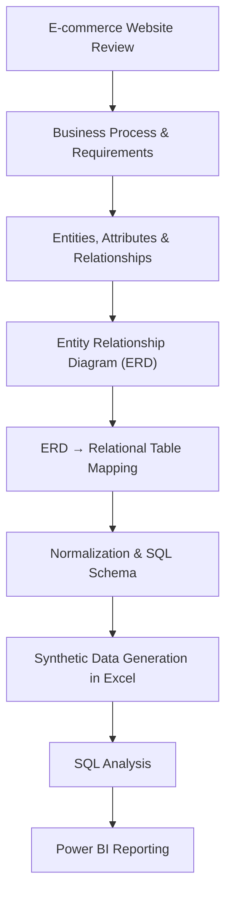

# 🌱 SeedSheets
### From Business Process to Database & Business Intelligence

**End-to-End Data Engineering · Database Design · Analytics**

Academic Team Project · **Ben-Gurion University**

*Turning an e-commerce workflow into a structured, queryable database and analytical reporting solution.*

[Explore the Workflow](#-end-to-end-workflow) · [Project Files](#-explore-the-project) · [Data Notice](#-data-ethics--scope)

---

## ✨ Project at a glance

**SeedSheets** is a multi-phase university team project exploring the full journey from **business requirements** to **relational database design**, **SQL implementation**, **synthetic data preparation**, and **business intelligence**.

Rather than starting with an existing ready-to-analyze dataset, the team began by examining a selected e-commerce website and documenting the **customer purchasing process**, including the flow from placing an order toward fulfillment. This process analysis guided the data model and the later implementation and reporting work.

| Focus | What the project demonstrates |
| :-- | :-- |
| 🔍 **Business analysis** | Understanding and documenting an end-to-end purchasing workflow |
| 🧩 **Data engineering foundations** | Translating requirements into entities, relationships, and relational tables |
| 🗄️ **Database development** | SQL schema design, keys, constraints, and queries |
| 🧪 **Data preparation** | Generating fictional records with Excel formulas such as LOOKUP |
| 📊 **Business intelligence** | Analyzing data and producing reports in Power BI |

## 🛠️ Tech stack

| Area | Tools & concepts |
| :-- | :-- |
| Database & querying | SQL Server, SQL |
| Modeling | ERD, relational schema mapping, normalization (including 3NF) |
| Data preparation | Microsoft Excel, LOOKUP and related formulas |
| Analytics & reporting | Power BI, SQL queries |
| Domain analysis | E-commerce workflow and requirements analysis |

## 🔄 End-to-end workflow

### 01 — Understand the business process
Analyze a course-selected e-commerce website and document the purchasing journey and related business rules. Identify the information the system must track.

### 02 — Design the data model
Identify entities, attributes, and relationships. Create an **ERD**, translate it into a **relational table model**, and apply normalization principles to improve structure and consistency.

### 03 — Implement the database
Create and query relational tables in SQL Server, working with primary and foreign keys, relationships, and constraints.

### 04 — Generate synthetic data
Build fictional customer and transaction datasets with Excel formulas, including **LOOKUP** and other spreadsheet functions, to support testing and analysis.

### 05 — Analyze and report
Use SQL and Power BI to explore the modeled data and communicate business-oriented insights.

## 📂 Explore the project

The original deliverables are preserved below. Documentation is divided into **three academic phases**.

| Deliverable | File |
| :-- | :-- |
| Phase 1 documentation | [PART 1.docx](PART%201.docx) |
| Phase 2 documentation | [PART2.docx](PART2.docx) |
| Phase 3 documentation | [PART3.docx](PART3.docx) |
| SQL script 1 | [SQLQuery4.sql](SQLQuery4.sql) |
| SQL script 2 | [SQLQuery8.sql](SQLQuery8.sql) |
| Excel workbook | [PART3.xlsx](PART3.xlsx) |
| Excel macro-enabled workbook | [PART3 search.xlsm](PART3%20search.xlsm) |
| Power BI report | [powerBI.pbix](powerBI.pbix) |

> **Viewing note:** Word, Excel, and Power BI project files may require the corresponding desktop applications to inspect fully. SQL scripts can be browsed directly on GitHub.

## 🔐 Data ethics & scope

**All customer, order, and transaction records in this project were synthetically generated for academic purposes. No real customer data was used.**

This is a **university team project**, not a production commerce platform. Any payment-related fields in the academic schema are conceptual modeling examples, **not a recommended approach to storing real payment credentials**.

## 🎓 Academic collaboration

Completed as a collaborative project at **Ben-Gurion University**. The repository documents the team's work and demonstrates practical foundations relevant to **Data Engineering, Database Development, Data Analytics, and Business Intelligence**.

---

**Business requirements → Data modeling → SQL → Synthetic data → Insights**

[⬆ Back to top](#-seedsheets)

